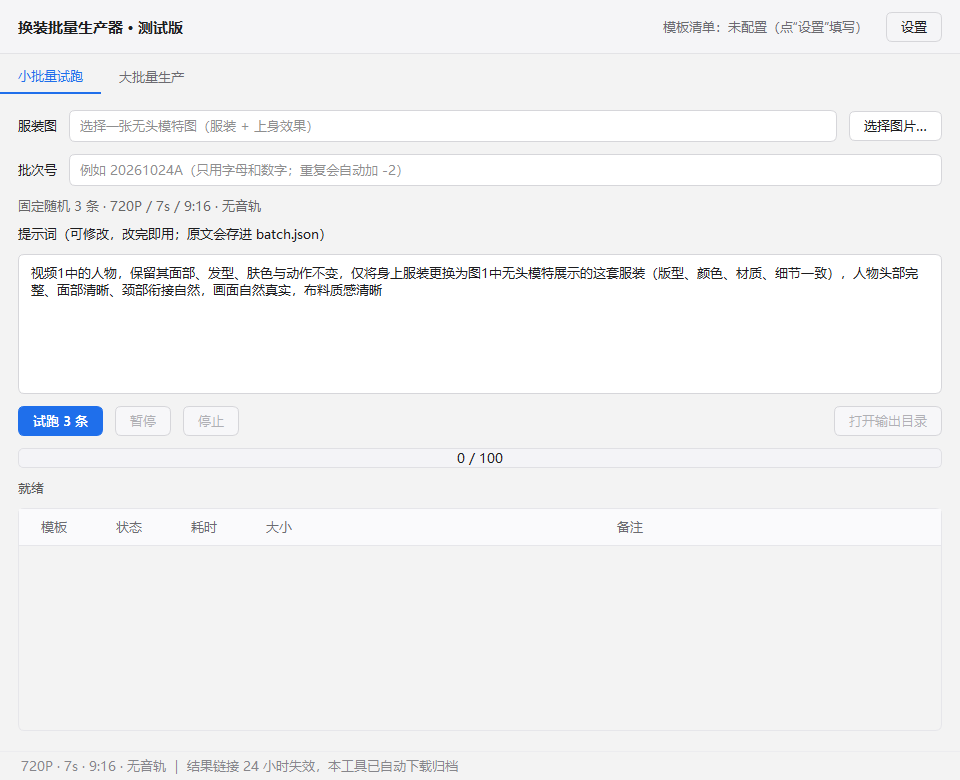

# 万相 3.0 换装批量生产线

1 张无头模特图 + 100 个视频模板 → 100 条 7 秒 720P 竖屏换装视频。

## 桌面软件（最终形态，v0.1 已打包）

**[换装批量生产器-v0.1.zip](dist/换装批量生产器-v0.1.zip)**（36.7 MB，解压后双击文件夹里的 exe）

> 文件夹版：exe 旁边必须有 `_internal\`，分发时发整个 zip，别只发 exe。



| 页面 | 用途 |
| --- | --- |
| 小批量试跑 | 随机 3 条，验提示词和效果 |
| 大批量生产 | 第 1–5 组（001–500）或随机 100 条，一次跑满 |

使用说明见 [app/README.md](app/README.md)；源码在 `app/`（`core.py` 引擎 + `main.py` 界面）。

## 命令行工具（同一套引擎，做批处理/演练用）

| 文件 | 作用 |
| --- | --- |
| [wan3_r2v.py](wan3_r2v.py) | 批量客户端：校验 / 上传 / 提交 / 轮询 / 下载 / 记账 |
| [make_batch.py](make_batch.py) | 清单 → 100 条任务文件 |
| [tools/build_manifest.py](tools/build_manifest.py) | 500 个模板 → `manifest.json`（含时长校验 + 海报） |
| [demo.py](demo.py) | 离线演练整条链路，不花钱 |

## 链路状态（已实测）

| 端点 | 真实服务返回 | 结论 |
| --- | --- | --- |
| `POST /alibaba/wan-3.0/reference-to-video` | `806 APIKEY_USER_NOT_FOUND` | 路径正确，仅缺有效 Key |
| `POST /query` | `806 APIKEY_USER_NOT_FOUND` | 路径正确 |
| `POST /media/upload/binary` | `API Key不存在` | 路径正确 |
| 随手编的 `wan-9.9/not-exist` | `1001 Invalid URL` | 对照组，说明上面是真的命中 |

> 离线演练已跑通 **100 条任务**（17 秒，假服务）。**现在只差三样：Key、500 个模板上 CDN、真实素材打样。**

## 现在就能跑（无需素材、无需 Key、不花钱）

```bash
python3 demo.py --count 5
```

或双击 **`一键演练.bat`**。

它会：造一张占位定妆图 → 起本地假服务 → 走完 **上传 / 提交 / 轮询 / 下载 / 记账** → 打印结果表。
产物在 `out/demo/`（假视频，仅证明链路通）。

## 素材好了之后（三步）

```bash
# 1) 定妆图放到 assets/定妆图.png（全身、正面、干净背景）
# 2) Key 放进环境变量
set RUNNINGHUB_API_KEY=你的32位Key

# 3) 先打样 1 条，确认换装效果与单价
python3 wan3_r2v.py run --tasks batch/tasks.batch.json --limit 1

# 4) 全量跑（并发 3~5，断点续跑）
python3 wan3_r2v.py run --tasks batch/tasks.batch.json --concurrency 4
```

## 成片归档到腾讯云 COS（推荐，10 分钟）

结果链接 **24 小时失效**，本地磁盘迟早会满。接一层 COS 后，成片才有长期地址：

```bash
# 0) 只有真传 COS 才需要
pip install cos-python-sdk-v5

# 1) 环境变量（子账号密钥，别用主账号）
set COS_BUCKET=video-prod-1250000000
set COS_REGION=ap-guangzhou
set COS_SECRET_ID=AKIDxxxxxxxx
set COS_SECRET_KEY=xxxxxxxx

# 2) 自检：写 → 签名 → 读 → 列举 → 删，全 ✓ 再继续
python3 scripts/cos_check.py

# 3) 历史成片补传（可重复执行，同一内容不会重复存）
python3 scripts/archive_to_cos.py --root out --dry-run
python3 scripts/archive_to_cos.py --root out
```

桌面版更省事：**设置 → 启用 COS 归档**，填桶名/地域/密钥 → 点「测试连接」→ 之后每批跑完自动上传，`batch.json` / `report.csv` 里会多出 `cos_key`。

建桶、CAM 最小权限策略、报错对照表、费用估算：见 **[docs/cos-setup.md](docs/cos-setup.md)**。

## 命令速查

| 命令 | 作用 |
| --- | --- |
| `python3 demo.py` | 离线演练整条链路 |
| `python3 wan3_r2v.py validate --tasks batch/tasks.batch.json` | 只校验，不发请求 |
| `python3 wan3_r2v.py build --tasks ... --index 0` | 看第 1 条的真实请求体 |
| `python3 wan3_r2v.py emit --tasks ... --out batch/requests.jsonl` | 导出 100 个请求原文 |
| `python3 wan3_r2v.py run --tasks ... --limit 1` | 打样 1 条 |
| `python3 wan3_r2v.py run --tasks ... --concurrency 4` | 全量生产 |
| `python3 wan3_r2v.py upload 文件` | 单独上传素材，返回 URL |
| `python3 wan3_r2v.py query <taskId>` | 复查某个任务 |
| `python3 scripts/cos_check.py` | COS 连通性自检（不花钱） |
| `python3 scripts/archive_to_cos.py --root out` | 本机成片补传 COS，回写 `cos_key` |

## 文件地图

| 文件 | 说明 |
| --- | --- |
| [batch/README.md](batch/README.md) | **生产流程、参数取舍、素材怎么给、成本工期** |
| [docs/wan-3.0-reference-to-video.md](docs/wan-3.0-reference-to-video.md) | 接口规格：字段表、约束、状态机、计费 |
| [docs/cos-setup.md](docs/cos-setup.md) | **腾讯云 COS 接入手册：建桶 / CAM 策略 / 报错表 / 费用** |
| `app/storage.py` | 存储适配层（COS / 本地），Key 规则、签名、分片上传 |
| `app/transfer.py` | 远端链接 → 对象存储的流式转存（解决 24h 失效） |
| `scripts/cos_check.py` | 五个原子操作自检 |
| `scripts/archive_to_cos.py` | 历史成片补传 + 回写状态 |
| `batch/outfits.tsv` | 100 行服装清单（服装 / 场景 / 镜头），直接改 |
| `batch/tasks.batch.json` | 生成出来的 100 条任务（改清单后用 make_batch.py 重新生成） |
| `batch/requests.jsonl` | 100 个请求原文，逐行可回放 |
| `make_batch.py` | 清单 → 任务文件的展开器 |
| `wan3_r2v.py` | 批量客户端：校验 / 上传 / 提交 / 轮询 / 下载 / 记账 |
| `tests/mock_runninghub.py` | 本地假服务（演练用） |

## 生产链路长什么样

```
定妆图（本地）
   └─ 上传 1 次 → URL（1 天有效）
        └─ 100 条请求共用 imageUrls
             ├─ POST /reference-to-video ×100  → taskId（秒回）
             ├─ POST /query 轮询 → SUCCESS
             ├─ 立刻下载 → out/*.mp4 + out/batch-state.json
             └─ （可选）同步 COS → output/日期/批次/编号-指纹.mp4
```

## 核心约定（别改错）

- `duration` 是**字符串**：`"7"`；
- 素材必须是 **URL 或 Base64**，本地路径由客户端自动上传；
- 换装不换人靠这句：`保持脸型、五官、发型与妆造完全不变，只更换服装`，且 prompt 里要有「图1」；
- 批量务必 `promptExtend: false`，否则 100 条风格会漂；
- 结果链接 **24 小时**失效，成功即下载。
